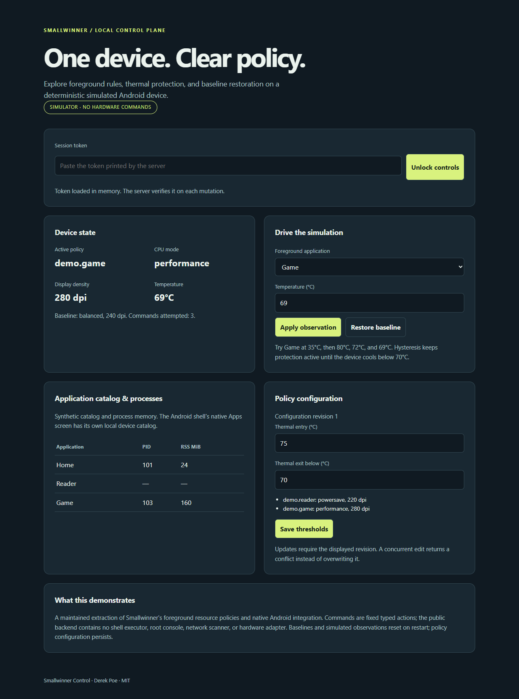

# Smallwinner Control

A local control plane for exploring Android foreground resource policies: select per-application CPU/display settings, restore a captured baseline, and apply thermal protection with hysteresis. A small Go service drives a deterministic simulated device; a companion Android shell keeps native application discovery and launch separate from web content.

This is a **simulation-first maintenance extraction** of my Smallwinner Android controller, not a claim that the original privileged controller is production ready. The foreground-policy, baseline-restoration, and thermal-hysteresis mechanisms are ported from the original. The simulator, typed command boundary, persistence transactions, request authentication, and tests are new maintenance work. See [provenance](docs/PROVENANCE.md).



## Run the simulator

Use Go 1.26 or newer on Linux or WSL. The backend uses Linux file locking; native Windows and real Android backend execution are outside this release's validation scope. No external Go modules, device, root access, model downloads, or external services are required.

```sh
go test -race ./...
go run ./cmd/smallwinner
```

Open **http://127.0.0.1:1717/**. Paste the random session token printed by the server into the page to unlock mutations. Use this exact address, not `localhost`: the server validates Host and Origin. The token is held only in page memory and changes each restart. Do not share the terminal output. Automation can provide a fresh 64-character hexadecimal `SMALLWINNER_TOKEN` through the process environment; it is never persisted by the application.

1. Select **Game**, set **35°C**, and apply: performance mode, 280 dpi.
2. Raise temperature to **80°C**: thermal protection selects balanced mode and the 240 dpi baseline.
3. Set **72°C**: protection remains active, avoiding rapid toggling around the entry threshold.
4. Set **69°C**: the Game policy resumes.
5. Select **Home** at 35°C: the captured baseline returns.

**Restore baseline** applies the baseline immediately and leaves it active until the next observation or configuration update. It is a manual simulator action, not a live hardware emergency control. There is no background telemetry loop in this release.

For reproducible JSON output with a new temporary configuration:

```sh
demo_state=$(mktemp -d)
go run ./cmd/smallwinner -demo -state "$demo_state" > demo.json
```

The six snapshots contain synthetic app/process data and resource transitions. The state directory contains only a versioned policy configuration and a lock file. See [demo and API guide](docs/DEMO.md).

## Structure and guarantees

| Component | Responsibility |
| --- | --- |
| `internal/control/model.go` | Validated rules, baseline-derived targets, thermal hysteresis |
| `internal/control/controller.go` | Serialized observations, config changes, and resource application; desired versus observed state |
| `internal/control/device.go` | Fixed typed actions, deadline/output bounds, deterministic device and process catalog |
| `internal/control/store.go` | Revision compare-and-swap, file synchronization and atomic rename, process ownership |
| `internal/web` | Embedded dashboard, strict Host/Origin, token-authenticated mutations, bounded request admission |
| `android` | Native local app catalog/launch UI and restricted backend WebView; no JavaScript/native bridge |

Configuration is committed before resource application. A failed application reports an error and exposes the actual observed resources; the persisted revision is still current. A failure before the simulator applies an action leaves those resources unchanged. A later observation retries the desired policy. A stale writer receives HTTP 409 and must reload. A corrupt configuration fails startup rather than silently resetting it.

The backend accepts at most four simultaneous mutation requests, a 16 KiB JSON body, and one serialized controller action at a time. Each command gets a 250 ms context deadline and a 1 KiB output allowance. The included simulator honors cancellation; future trusted adapters would also have to do so. This does not forcibly terminate arbitrary native code. No subprocess or privileged adapter is included.

The local store requires a private, trusted directory on a local Linux filesystem with `flock` and atomic same-directory rename. File contents are synchronized before rename; directory synchronization after commit is best effort. This is not a distributed store, a hardened shared filesystem service, or a guarantee against power loss on every filesystem. A killed process releases its OS lock; restart preserves committed configuration and creates a fresh baseline and simulator observation.

## Android and trust boundary

The Android shell loads the fixed loopback dashboard, with native **Apps**, **Refresh**, and **Retry** controls. App catalog/launch capabilities never cross a JavaScript interface. Its catalog refers to apps on the Android device; the browser dashboard's catalog is explicitly synthetic. The two catalogs are not synchronized in this release.

See [Android build and security notes](android/README.md) for device-free checks and the optional native shell. This release uses the simulator by choice. It makes no current tablet, rooted-device, Magisk, accessibility-key, battery, thermal-safety, or performance claim.

Read-only simulator state is available to local clients without the session token. Mutations require both the token and the exact origin. There is no CORS allowance, shell endpoint, root console, arbitrary executable/path action, or network scanner. These controls protect the browser boundary, not against a malicious process already running as the same local user. See [security and API contract](docs/SECURITY.md).

## Validation

```sh
go test -race ./...
go vet ./...
go build ./cmd/smallwinner
```

Tests cover thermal threshold boundaries, foreground changes during throttling, direct rule updates/removal, baseline restoration, retry after failed commands, cancellation/output limits, concurrent observations, competing configuration revisions, atomic readers, abrupt child-process exit/restart, failed persistence, and HTTP boundary failures. CI also runs the Android module's unit/build checks. Browser walkthrough evidence and physical-device evidence are distinct; this release targets the simulator.

Current local evidence: **14 Go tests (46 including subtests)** passed with the race detector on Go 1.27.2/Linux, plus `go vet`, build, and JavaScript syntax checks. Two independent CLI demo runs produced identical six-state JSON. A real Chromium 155 browser walkthrough verified authentication, Host/Origin rejection, revision conflicts, thermal transitions, restoration, token loss on reload, responsive layout, and no external requests or browser storage. [Browser result](docs/demo/browser-result.json) · [mobile screenshot](docs/demo/mobile.png). Android build/test evidence is documented separately in its README.

MIT, Derek Poe. [Third-party notices](THIRD_PARTY_NOTICES.md).
